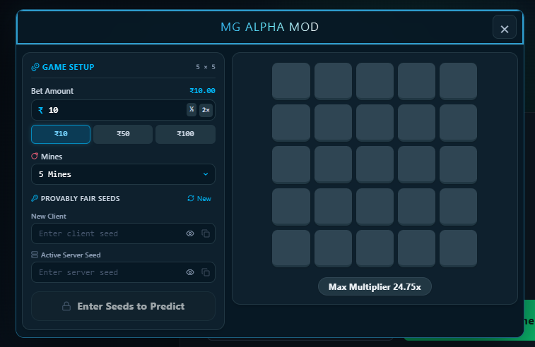

# Stake Predictor

## 1. Project Overview

Stake Predictor is a responsive React and Vite web application. It includes:

- Stake activation-code landing flow
- Welcome page with **Start Panel** and **Enter in Game**
- Floating and draggable **MG ALPHA MOD** panel
- Responsive mines prediction board
- Bet, mine-count, provably-fair seed, prediction, sound, show/hide, and copy controls
- Mobile, tablet, laptop, and desktop layouts

The project can be packaged as one Flutter application for both Android and iOS. Flutter provides the native app shell, while the existing responsive React web application is loaded inside a WebView.

## 2. Requirements

Install the following tools:

1. Node.js 20 or newer
2. npm
3. Android Studio with Android SDK
4. Java JDK 17 or newer
5. An Android device or emulator

Confirm the installations:

```bash
node --version
npm --version
java -version
```

## 3. Run the Web Project

From the project root:

```bash
npm install
npm run dev
```

Open the local address printed by Vite, usually:

```text
http://localhost:5173
```

Create a production build:

```bash
npm run build
```

The generated files will be stored in `dist/`.

## 4. Convert the Project to Flutter for Android and iOS

Flutter will create the native application shell. The React application remains the main UI and runs locally inside a WebView, allowing the same APK/AAB and iOS build workflow to use the same project assets.

### 4.1 Create the Flutter Project

Install Flutter and confirm it:

```bash
flutter doctor
flutter --version
```

Create the native wrapper outside the React root:

```bash
cd ..
flutter create stake_predictor_mobile
cd stake_predictor_mobile
flutter create --platforms=android,ios .
```

### 4.2 Add the WebView Packages

Add these packages:

```bash
flutter pub add webview_flutter
flutter pub add webview_flutter_android
flutter pub add webview_flutter_wkwebview
flutter pub add connectivity_plus
flutter pub add url_launcher
flutter pub get
```

### 4.3 Copy the React Build

From the React project directory, build the web assets and copy them into the Flutter project:

```bash
cd /path/to/StakePredictor
npm run build
```

Copy the complete contents of `dist/` into:

```text
stake_predictor_mobile/assets/web/
```

The Flutter assets folder must contain at least:

```text
assets/web/index.html
assets/web/assets/
```

Declare the assets in `pubspec.yaml`:

```yaml
flutter:
  uses-material-design: true
  assets:
    - assets/web/
    - assets/web/assets/
```

### 4.4 Android Minimum Configuration

Open `android/app/build.gradle.kts` and confirm:

```kotlin
android {
    defaultConfig {
        applicationId = "com.example.stakepredictor"
        minSdk = 23
        targetSdk = 35
        versionCode = 1
        versionName = "1.0"
    }
}
```

Use a unique application ID before releasing the app.

### 4.5 iOS Minimum Configuration

In `ios/Runner/Info.plist`, set the app name and orientation support:

```xml
<key>CFBundleDisplayName</key>
<string>Stake Predictor</string>
<key>NSAppTransportSecurity</key>
<dict>
    <key>NSAllowsArbitraryLoads</key>
    <false/>
</dict>
```

For a physical iOS device, select the **Runner** target in Xcode, then configure a valid Apple development team and bundle identifier.

## 5. Load the React Application in Flutter

Replace `lib/main.dart` with a local WebView application:

```dart
import 'package:flutter/material.dart';
import 'package:webview_flutter/webview_flutter.dart';
import 'package:webview_flutter_android/webview_flutter_android.dart';
import 'package:webview_flutter_wkwebview/webview_flutter_wkwebview.dart';

void main() => runApp(const MyApp());

class MyApp extends StatelessWidget {
  const MyApp({super.key});

  @override
  Widget build(BuildContext context) {
    return const MaterialApp(
      debugShowCheckedModeBanner: false,
      home: AppWebView(),
    );
  }
}

class AppWebView extends StatefulWidget {
  const AppWebView({super.key});

  @override
  State<AppWebView> createState() => _AppWebViewState();
}

class _AppWebViewState extends State<AppWebView> {
  late final WebViewController controller;

  @override
  void initState() {
    super.initState();

    late final PlatformWebViewControllerCreationParams params;
    if (WebViewPlatform.instance is WebKitWebViewPlatform) {
      params = WebKitWebViewControllerCreationParams();
    } else {
      params = const PlatformWebViewControllerCreationParams();
    }

    controller = WebViewController.fromPlatformCreationParams(params)
      ..setJavaScriptMode(JavaScriptMode.unrestricted)
      ..setBackgroundColor(Colors.transparent)
      ..loadFlutterAsset('assets/web/index.html');

    final platformController = controller.platform;
    if (platformController is AndroidWebViewController) {
      AndroidWebViewController.enableDebugging(true);
    }
  }

  @override
  Widget build(BuildContext context) {
    return SafeArea(
      child: WebViewWidget(controller: controller),
    );
  }
}
```

Vite asset URLs should remain relative. The existing `base: './'` setting supports loading the React build from Flutter assets.

## 6. Responsive Flutter WebView Configuration

The Flutter shell should use `SafeArea`, and the WebView should fill the remaining screen. The React CSS already handles phone, tablet, laptop, and desktop widths.

For tablets, allow landscape orientation. If portrait-only behavior is required, limit orientations in Flutter:

```dart
await SystemChrome.setPreferredOrientations([
  DeviceOrientation.portraitUp,
]);
```

## 7. Run Android and iOS

### Android Emulator

Open the Flutter project in Android Studio, or run:

```bash
flutter devices
flutter run -d <android-device-id>
```

To create an emulator manually:

1. In Android Studio, open **Device Manager**.
2. Create a Pixel or compatible virtual device.
3. Start the emulator.
4. Select the emulator in the top toolbar.
5. Click the green **Run** button.

### Android Physical Device

1. Enable **Developer options** on the phone.
2. Enable **USB debugging**.
3. Connect the phone by USB.
4. Approve the debugging request on the phone.
5. Select the phone in Android Studio.
6. Click **Run**.

### iOS Simulator and Device

On macOS:

```bash
cd ios
pod install
cd ..
flutter run
```

For an iOS device:

1. Connect the device.
2. Open `ios/Runner.xcworkspace` in Xcode.
3. Select the **Runner** target.
4. Configure your Apple development team.
5. Select the physical device and run.

## 8. Build APK, Android App Bundle, and iOS IPA

### Debug APK for Testing

Android Studio also supports Flutter APK builds, but these release commands are recommended:

```bash
flutter build apk --debug
flutter build apk --release
```

Debug output is normally created at:

```text
build/app/outputs/flutter-apk/app-debug.apk
build/app/outputs/flutter-apk/app-release.apk
```

### Release APK

Create a release keystore:

```bash
keytool -genkey -v -keystore upload-keystore.jks -keyalg RSA -keysize 2048 -validity 10000 -alias upload
```

Configure signing using `android/key.properties` and `android/app/build.gradle.kts`.

Build a signed Play Store bundle:

```bash
flutter build appbundle --release
```

Output:

```text
build/app/outputs/bundle/release/app-release.aab
```

Upload the signed AAB to Google Play Console.

### iOS Release Archive

```bash
flutter build ios --release
```

Then:

1. Open `ios/Runner.xcworkspace` in Xcode.
2. Select **Any iOS Device**.
3. Choose **Product > Archive**.
4. Upload the archive through Xcode Organizer, or distribute it with a valid signing profile.

## 10. Keystore Backup

Never commit release passwords or `.jks`/`.keystore` files to Git.

Keep these four items backed up:

- Keystore file
- Keystore password
- Key alias
- Key password

The release key is required to update an application already published on Google Play.

## 11. Recommended Flutter Packages

Useful packages:

```yaml
dependencies:
  flutter:
    sdk: flutter
  webview_flutter: latest
  connectivity_plus: latest
  url_launcher: latest
```

## Native Android Technology Options

The Android wrapper can be created in either **Kotlin** or **Java**.

### Kotlin Android Wrapper

Use Kotlin for the recommended Android implementation:

```text
android/app/src/main/kotlin/
```

Suggested Kotlin classes:

- `MainActivity.kt` for the Android activity
- `WebAppInterface.kt` for JavaScript-to-Android communication
- `AppPreferences.kt` for app settings

Enable WebView support in Gradle:

```kotlin
android {
    compileSdk = 35

    defaultConfig {
        applicationId = "com.example.stakepredictor"
        minSdk = 23
        targetSdk = 35
    }
}

dependencies {
    implementation("androidx.webkit:webkit:1.12.1")
    implementation("androidx.core:core-ktx:1.15.0")
}
```

Example Kotlin WebView activity:

```kotlin
class MainActivity : ComponentActivity() {
    override fun onCreate(savedInstanceState: Bundle?) {
        super.onCreate(savedInstanceState)

        val webView = WebView(this)
        webView.settings.javaScriptEnabled = true
        webView.settings.domStorageEnabled = true
        webView.webChromeClient = WebChromeClient()
        webView.webViewClient = WebViewClient()
        webView.loadUrl("file:///android_asset/index.html")
        setContentView(webView)
    }
}
```

### Java Android Wrapper

Java is also supported when maintaining an existing native Android project or team preference:

```text
android/app/src/main/java/
```

Example Java WebView activity:

```java
public class MainActivity extends AppCompatActivity {
    @Override
    protected void onCreate(Bundle savedInstanceState) {
        super.onCreate(savedInstanceState);

        WebView webView = new WebView(this);
        WebSettings settings = webView.getSettings();
        settings.setJavaScriptEnabled(true);
        settings.setDomStorageEnabled(true);
        webView.setWebViewClient(new WebViewClient());
        webView.loadUrl("file:///android_asset/index.html");
        setContentView(webView);
    }
}
```

### Kotlin or Java Recommendation

- Use Kotlin for new Android applications.
- Use Kotlin for Android Studio templates and Jetpack Compose.
- Use Java only when required by an existing Java codebase or organization standard.
- Kotlin and Java can coexist in the same Android project, but Kotlin is recommended for new code.

The Vite build uses relative assets:

```js
export default defineConfig({
  base: './',
  plugins: [react(), tailwindcss()],
})
```

## 12. External Links on Android and iOS

The React **Enter in Game** button can continue to use `window.open(...)` for normal web builds. In Flutter, external links should be opened with `url_launcher`, and navigation policies should be configured in the WebView when needed.

## 13. Android and iOS Security

For normal use of bundled React assets, no special Android storage permission is required.

If external browser access is added, verify Android's `usesCleartextTraffic`, network security configuration, and URL allowlist are configured correctly. Use HTTPS URLs for production.

Do not commit API keys, activation codes, private keys, keystores, Apple certificates, provisioning profiles, or passwords.

## 14. Troubleshooting

### Gradle synchronization fails

- Install Android SDK Platform Tools and the recommended SDK Platform.
- In Android Studio, use **File > Sync Project with Gradle Files**.
- Accept requested SDK licenses.
- Use Gradle JDK 17.

### White screen in Android

```bash
npm run build
flutter clean
flutter pub get
flutter run
```

Confirm that:

- `assets/web/index.html` exists in the Flutter project
- Vite's build succeeds
- `dist/index.html` exists
- The complete React build is copied into `assets/web`
- `pubspec.yaml` includes the `assets/web/` paths
- `vite.config.js` contains `base: './'`

### External site does not open

Install and configure `url_launcher`, or update the WebView navigation policy.

### Changes are missing on the phone

Run:

```bash
rm -rf assets/web
npm run build
cp -R dist assets/web
flutter pub get
flutter run
```

Then reinstall or click Run in Android Studio.

## 15. Common Commands

```bash
npm run dev
npm run build
flutter doctor
flutter pub get
flutter run
flutter build apk
flutter build appbundle
flutter build ios
](image.png)```
